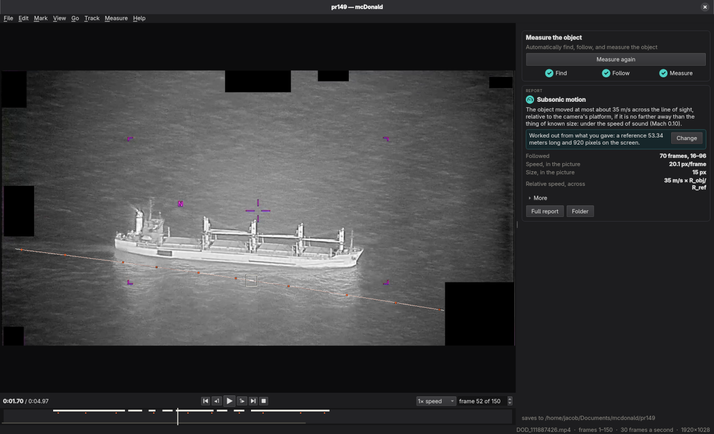
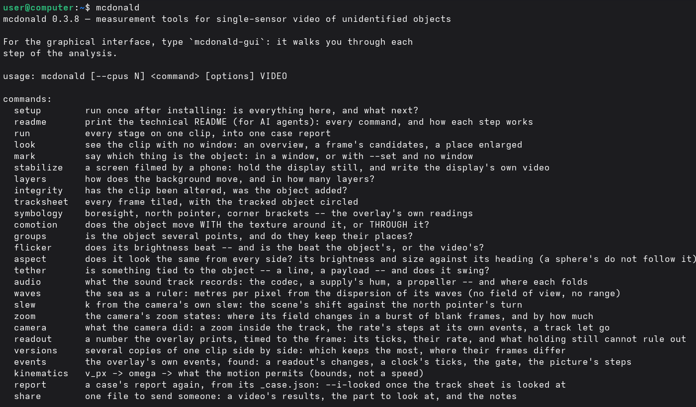

<div class="hero" markdown>

<h1 class="hero-logo">
  
  
</h1>

**mcDonald** is a frame-by-frame analysis toolkit for measuring the kinematics of an unknown object in a
single-camera video.

[Install](#install){ .md-button .md-button--primary }
[Try an exercise](exercises/README.md){ .md-button }
[Read the papers](publications.md){ .md-button }

</div>

mcDonald is a deterministic and multi-platform open source tool to drive scientific investigation of Unidentified Anomalous Phenomena. The toolkit works on any video, optical or infrared, including the PURSUE sensor videos or any of your own. The **mcDonald UAP Toolkit** is part of [Project Janus](https://janus.bluemarblespace.org/) by [Blue Marble Space](https://www.bluemarblespace.org/).


## Two ways to use mcDonald

<div class="grid cards" markdown>

-   :material-application-outline:{ .lg } **Graphical Interface**

    ---

    [](assets/screenshot-gui.png)

    Intended for people. mcDonald walks you through each step. Click the icon to launch or type:

    ```bash
    mcdonald-gui
    ```

-   :material-console:{ .lg } **Command Line**

    ---

    [](assets/screenshot-cli.png)

    Intended for developers, advanced users and AI agents. Type commands in a shell prompt.

    ```bash
    mcdonald
    ```

</div>

## Install

<!-- README: Install -->
