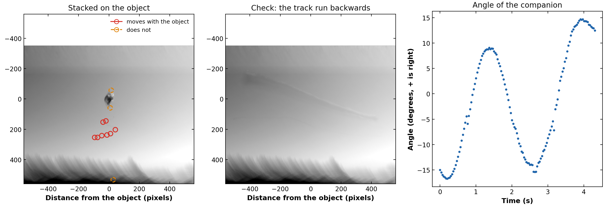
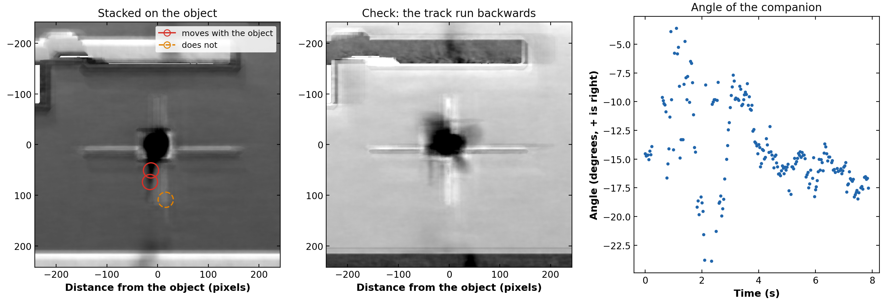
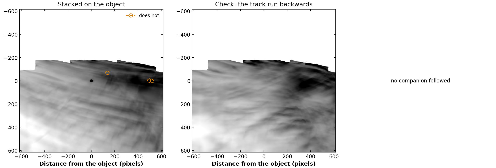

# `mcdonald tether`: does it work?

Three clips, each with the stage's own figure as the command writes it
(`<tag>_tether.png`): a pico balloon whose line is known; the Lake Huron object whose
pilots reported "strings hanging off"; a sphere among clouds where nothing is tied. In
each figure the left panel is the frames stacked on the object, the middle one the check
(the same frames stacked on the track run backwards), and the right one the angle of
the feature that moves with the object, on the frames that show it.

The numbers are those of 0.5.2, which finds a companion again on the frames from where
the stack put it, never follows it away, and holds a swing's period against a slow
wander (`docs/method.md` § 6 has the method, the null its numbers were set against, and
the cases its four defects were found on).

## WA9ONY-5 — the calibration

A ham-radio pico balloon launched 2021-07-13 (YouTube `tl8_etApsro`, Sony camera,
1080p30), a 13 g WB8ELK Skytracker payload under a mylar balloon. The builder's own
assembly video (`fU5cbNv_oiQ`, at 3:22) gives the ground truth: *"a swivel, and then
about a little over one meter of cable, which is attached to the bottom of the balloon."*

Free flight 84–92 s; the balloon tracked 85.8–90.0 s (after that the tracker jumps onto
the payload, and the track is cut there — `tests/golden/wa9ony5_balloon_track.csv`).



- Stacked on the balloon, the payload is a dark arc below it: it swings, and the balloon
  is rising away from the camera, so its place against the balloon moves from 277 px to
  120 px in four seconds, and the stack shows several points of that arc. The
  nearest one the follower holds throughout is 238 px (4.9 object sizes) out, **7.4 ×
  the stack's noise**; at the same place on the reversed track, **0.3 ×** (the
  strongest, 265 px out, is 30 × and 0.7 ×, and leads to the same payload).
- Found again from there on all 130 frames, in one stretch, to 0.4 px, making
  none (−0.02) of the scene's motion against the balloon. The angle is a clean sinusoid:
  **T = 2.58 ± 0.02 s, amplitude 12.8°, 1.7 cycles (tentative), L = gT²/4π² = 1.66 ± 0.03 m.**
  No slow wander of 2,000 drawn with the angle's own size and correlation is as strong.
- Known: ~1.05 m of line. The pivot of a balloon's pendulum is the balloon's centre, not
  its neck — a balloon's inertia is mostly the air it displaces — so the pendulum is the
  line plus the balloon's radius (~0.3–0.4 m for an under-filled 36-inch pico balloon) plus
  the payload's own offset below the swivel: ≈ 1.5 m.
- The error is statistical (a block bootstrap of the fit's residuals). The 1.7 cycles are
  why the tool calls it tentative; the periodogram on this window peaks at 2.8 s, which is
  the window's cap, not a period — the reason the sinusoid is the estimator.

A second camera on the same launch (iPad, `ap2nxbCL3T8`, 608×1080) is too shaky for an
independent number: 2.5–3.5 s, noisy.

## PR071 — a line, held steady

The Lake Huron object (2023-02-12), frames 367–603 (12.2–20.1 s), the object held in the
pod's tracking gate.



- A thin dark line hangs from the object's underside in every frame. Stacked on the
  object it stays sharp, **1.6 object sizes below, 14° left of straight
  down, 5.9 × the noise**, while the gate's box doubles (the tracker lags); on the
  reversed track it is gone (1.3 ×).
- Found again on 92 % of the frames to 0.5 px, it holds its angle,
  **−14 ± 3.6° over 7.9 s**: no swing, so no length. A line held by drag, or
  stiff. Along a line the darkest point wanders with what passes behind it, so it makes
  0.21 of the scene's motion, where a compact companion makes none.

Before the overlay's strokes were masked, two bright gate-box edges passed every test:
they *are* tied to the object, by the tracker. With the strokes masked, the string is
what is left.

## PR055 — the null

The sphere among clouds (AFG, 2020), the original frames 1068–1300, the sphere 24 px.



- Nothing inside 10 sizes of the sphere; no parachute streamer at 1–2 sizes.
- The stacks are cloud streaks either way. The strongest features (6 to 22 sizes out)
  pass the reversed-track control, because cloud texture is dark *somewhere* in any
  patch on most frames.
- Found again frame by frame, they make 0.84 to 0.94 of the clouds' motion against the
  sphere: they are the scene's. **Nothing tied**, and the finding says where that was
  looked for: between 29 and 960 px of the sphere.

## Reproduce

```bash
# PR071, PR055 and the balloon (tl8_etApsro.mp4) are read from the reference-data folder:
# $MCDONALD_DATA, else data/mcdonald beside the repository (tests/reference_data.py)
python3 tests/test_golden.py                                # with the videos; the tether cases take about half an hour
python3 tests/test_tether.py                                # the portable checks, about a minute
mcdonald tether tl8_etApsro.mp4 --track tests/golden/wa9ony5_balloon_track.csv --r-max 12
mcdonald tether PR071 --track tests/golden/pr071_object_track.csv --r-max 6
mcdonald tether PR055 --track tests/golden/pr055_sphere_track.csv --size 24
```
